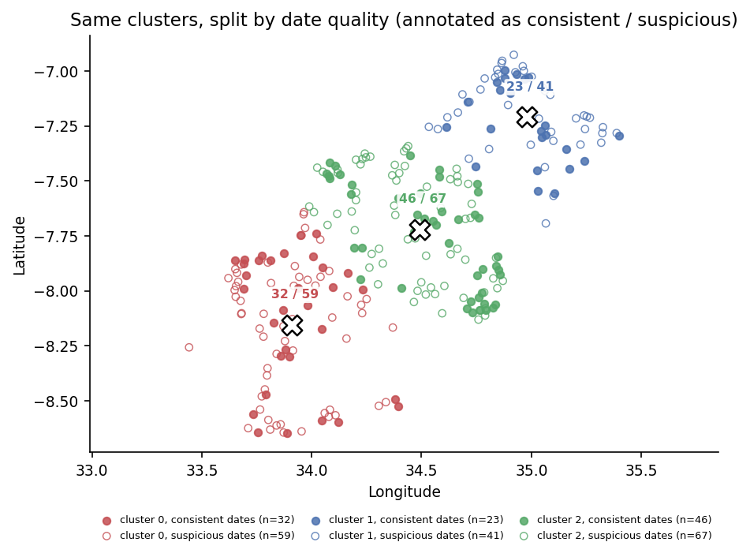

Data science student at the **University of Macau** (CISC7204 Data Science and Data
Visualization, CISC7026 Introduction to Deep Learning). I like turning small, messy datasets
into something you can look at and argue with - and I try to be explicit about what the data
does *not* support.

## About me

I am currently finishing my coursework in data science, working mostly in Python: cleaning
tables with pandas, checking them before trusting them, and then choosing a visualisation that
answers one question well instead of five badly.

The project below is a good example: 268 incident reports, a spatial question, and a data
dictionary that turned out to be wrong.

## Technical skills

- **Python** - pandas, NumPy, scikit-learn, matplotlib, seaborn
- **Deep learning** - PyTorch (feed-forward networks, training and evaluation loops)
- **Geospatial visualisation** - geoplotlib, coordinate data, k-means clustering
- **Tools** - Jupyter Notebook, Git / GitHub, Markdown

## Project showcase

### Reported poaching incidents in Tanzania (2005-2015)

**Research question:** where are the 268 reported poaching incidents concentrated, and how
much can the dates in the dataset actually tell us?

**What I found**

- The largest of three spatial clusters holds **113 of 268 reports (42.2%)**, centred near
  **34.49 E, 7.72 S**; a cluster-free hexbin view picks out the same hotspot (busiest cell: 6
  reports).
- **The data dictionary does not hold:** in **62.3%** of rows the "report created" date is
  *earlier* than the incident date, and one incident date is reused 9 times. So I dropped the
  seasonality idea and reported the date problem instead.
- **The hotspot survives the date problem:** split by date quality, the largest cluster still
  holds **45.5%** of the date-consistent rows (101) and **40.1%** of the suspicious ones (167),
  against 42.2% overall - so the concentration is not an artefact of the bad dates.
- **Limitation:** there is no denominator (patrol effort, protected-area size), so these are
  268 *reports* - the clusters show where incidents were reported, not where poaching is worst.

*The robustness check: filled markers are rows whose dates are consistent, open markers the ones
that are not, with the counts annotated per cluster.*

**Status:** completed

**Code and data:** [data-science-project](https://github.com/3gg3g3g3g/data-science-project)

## What I want to improve next

Two things a peer reviewer suggested, and one of my own. From the review: test 2, 4, 5 and 6
clusters and report how much the 42% share moves (the count of three is still my choice), and add
the low end of the density scale so a cell with 2 reports does not look as different as it should.
Mine: add protected-area boundaries and a real basemap so the clusters can be checked against the
parks they fall inside.

---

*Built with GitHub Pages. The project repository contains the notebook, the data, the
requirements file and the figures.*
